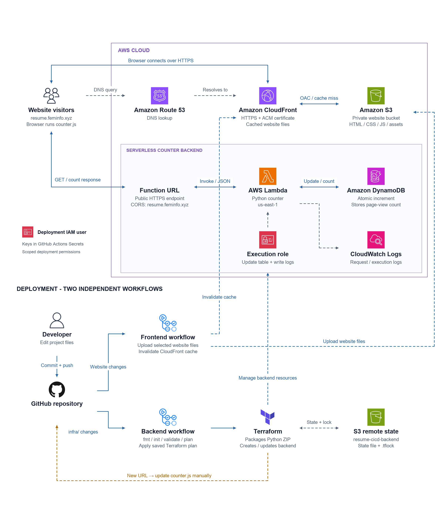

# AWS Cloud Resume Challenge

After passing the AWS Cloud Practitioner and Solutions Architect – Associate exams, I wanted to put what I learned into practice. I built this resume website as part of the [AWS Cloud Resume Challenge](https://cloudresumechallenge.dev/docs/the-challenge/aws/), working on it around my day job and during my commute.

**Live website:** [resume.feminfo.xyz](https://resume.feminfo.xyz/)

## Architecture

Route 53 points my domain to CloudFront, which serves the website over HTTPS from a private S3 bucket. The website calls a Lambda Function URL to increase the page-view count in DynamoDB and display the result.

Two GitHub Actions workflows handle deployment: one uploads website changes to S3 and invalidates the CloudFront cache; the other checks and applies the Terraform backend configuration. Terraform state is stored in a separate S3 bucket. If recreating the backend changes the Function URL, I update it in the website's JavaScript and push the change to GitHub. This triggers the frontend workflow to deploy the update.

## Progress

- ✅ Choose a resume template
- ✅ Add my CV content
- ✅ Host the website with HTTPS and my custom domain
- ✅ Build and manually test the page-view counter
- ✅ Define the backend API resources as code using Terraform
- ✅ Automate frontend deployment with GitHub Actions
- ✅ Automate backend deployment with Terraform and GitHub Actions
- ✅ Add the architecture diagram
- [ ] Publish the write-up and video walkthrough

## Decisions and troubleshooting

- **Private S3 bucket:** CloudFront accesses the website files through Origin Access Control, so the bucket does not need public access.
- **Public counter endpoint:** The website can call Lambda without asking visitors to sign in. CORS allows browser requests from my website, but does not prevent direct requests or inflated counts. This counts page loads, not unique visitors.
- **Extra counter increments:** Opening the Function URL increased the count by two in Brave and sometimes four in Safari, but Lambda tests increased it by one. I added logging and found extra requests for `/favicon.ico` (the browser tab icon) in CloudWatch. Ignoring these requests before updating DynamoDB stopped them from increasing the count.
- **Old JavaScript after deployment:** S3 contained the new Function URL, but my browser still used the old script. Invalidating CloudFront and clearing the browser cache resolved it.

## Personal goal

- [ ] Define the entire architecture using Terraform, including website hosting, DNS, and HTTPS certificates, to make it fully reproducible.

Frontend adapted from the Start Bootstrap Resume template. See [LICENSE](LICENSE).
